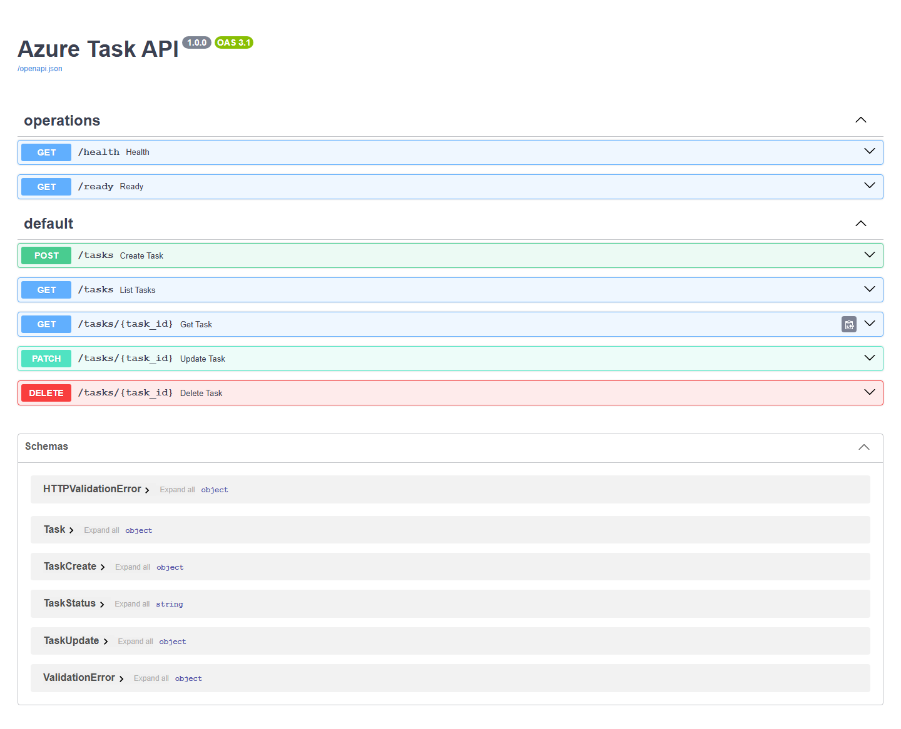
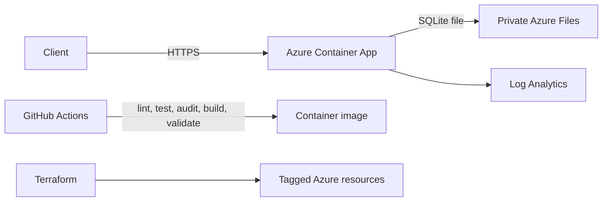

# Azure Terraform & DevOps Lab



[Mobile OpenAPI screenshot](docs/screenshots/mobile.png)

A production-minded task API that demonstrates Python API engineering, persistent storage, containerisation, Azure infrastructure as code, observability and controlled CI/CD. It runs locally without an Azure account; Terraform is declarative and **does not provision resources unless an operator explicitly applies it**.

**Status:** portfolio lab, locally verified on 14 November 2026. See [VERIFICATION.md](VERIFICATION.md) for commands, results and boundaries.

## Architecture



The deliberately small API exposes typed CRUD endpoints, `/health`, `/ready`, OpenAPI at `/docs`, request IDs and JSON logs. SQLite keeps local operation simple; Azure Files supplies persistent storage in the lab topology. For multi-instance production throughput, migrate to Azure Database for PostgreSQL.

## Run locally

```powershell
py -m venv .venv
.venv\Scripts\Activate.ps1
pip install -r requirements.txt
uvicorn app.main:app --reload
```

Open `http://127.0.0.1:8000/docs`. Run verification with `pytest` and `ruff check app tests`. Docker users can run `docker build -t task-api .` then `docker run --rm -p 8000:8000 -v task-data:/data -e DATABASE_PATH=/data/tasks.db task-api`.

## API example

```bash
curl -X POST http://127.0.0.1:8000/tasks -H "Content-Type: application/json" -d '{"title":"Review deployment"}'
curl http://127.0.0.1:8000/tasks
```

## Terraform safety

`terraform -chdir=infra init -backend=false` and `terraform -chdir=infra validate` are safe validation commands. Applying requires an Azure subscription, authenticated provider, an approved immutable `container_image`, a reviewed plan and explicit operator approval. Estimated charges, policy constraints and globally unique names must be reviewed first. Destroy with `terraform destroy` only after confirming the exact workspace and plan.

## CI/CD and rollback

Pull requests lint, test, audit dependencies, build the image, validate Terraform and run Checkov. Deployment is intentionally gated behind the `production` environment and remains a documented placeholder until Azure OIDC is configured. Use immutable image digests. Roll back by restoring the previous digest and applying a reviewed plan; database backups must be restored separately if a migration is incompatible.

## Evidence and limitations

See exact test and scan output in the portfolio-level report. Terraform 1.16.6 formatting, provider initialization and validation passed locally; Checkov passed 17 checks and left four documented production controls. Docker remains unverified. Authentication, WAF, private ingress, remote Terraform state, backup policy and a managed relational database are production follow-ups. No Azure resources were created.

For an interview walkthrough, use [TWO_MINUTE_DEMO.md](TWO_MINUTE_DEMO.md).

## Recruiter evidence

- Desktop and mobile screenshots show the real local OpenAPI interface.
- Automated API tests and Ruff checks pass locally.
- Terraform formatting, initialization and validation evidence is recorded without provisioning Azure resources.
- [ARCHITECTURE.md](ARCHITECTURE.md), [INTERVIEW_GUIDE.md](INTERVIEW_GUIDE.md) and [TWO_MINUTE_DEMO.md](TWO_MINUTE_DEMO.md) support a short technical review.
- Docker execution and Azure deployment remain explicitly unverified.

## Repository topics

`azure`, `terraform`, `fastapi`, `docker`, `github-actions`, `devops`, `python`, `portfolio`
